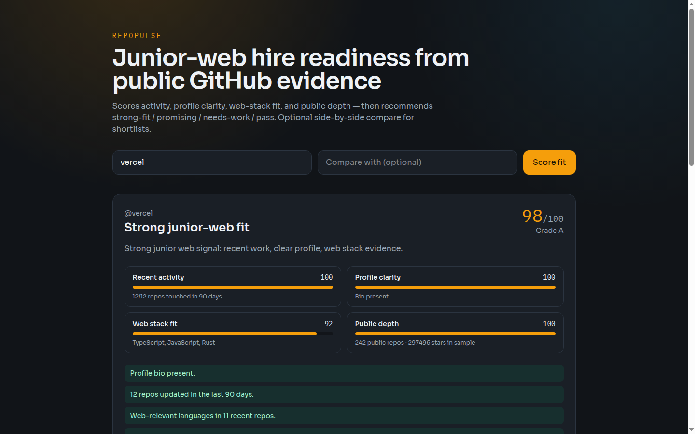

# RepoPulse

**Real problem:** people waste interview time on junior candidates with weak public proof.

**Solution:** score GitHub profiles for junior-web fit using recent activity, profile clarity, web languages, and public depth — with optional head-to-head compare. **No account needed.**

## Mockup



## Live demo

https://stefandevelops.github.io/repopulse/

## Solves

- “Should I interview this junior web candidate?”
- “Who looks stronger between two GitHub profiles?”
- “What public gaps should this person fix before applying?”

## Stack

Next.js, TypeScript, GitHub REST API, Tailwind

## Run locally

```bash
npm install
npm run dev
```

http://127.0.0.1:43122

## CV line

Built a GitHub scoring tool that turns public repository evidence into junior-web hire/pass recommendations and candidate comparisons.
